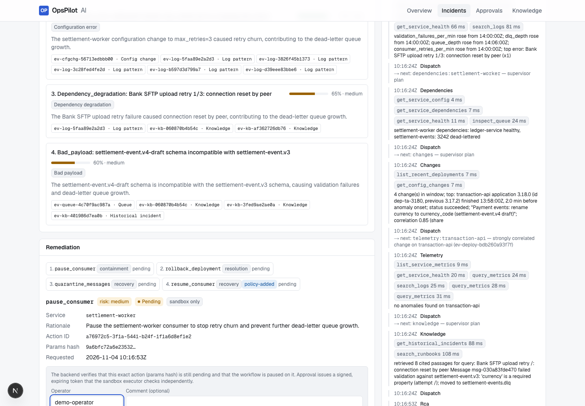
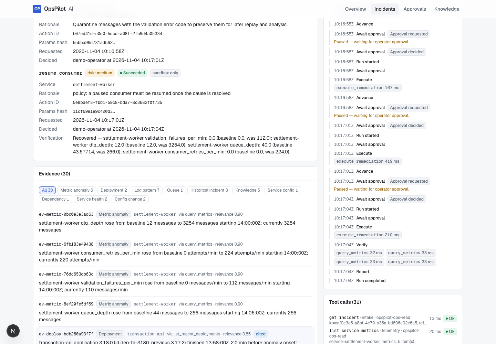
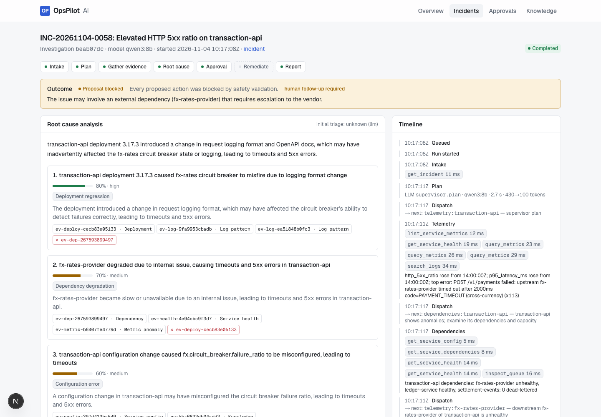
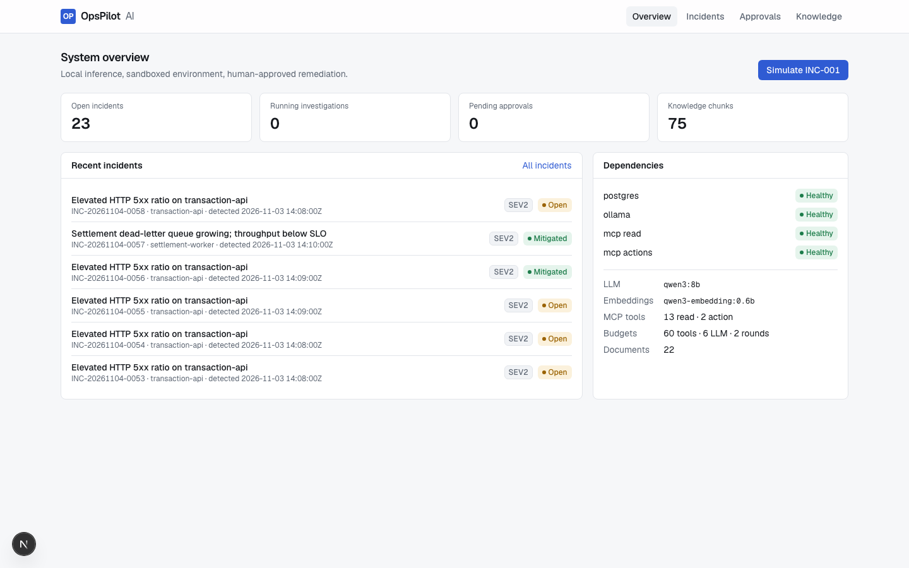

# OpsPilot AI

**Local-first, agentic incident investigation.** OpsPilot correlates telemetry, change history,
service dependencies and operational knowledge to produce evidence-cited root-cause hypotheses,
proposes a remediation from a fixed catalogue, **waits for a human to approve it**, executes it in
a sandbox, verifies recovery and writes an RCA report.

Everything runs on one laptop: open-weight models via native Ollama, one PostgreSQL (with
pgvector), no paid APIs, no cloud services, no production access.

```
Alert ─► LangGraph investigation ──► MCP tools ──► simulated payment platform
            │  supervisor plan            (logs, metrics, deploys, deps, health)
            │  telemetry / dependencies / changes / knowledge (hybrid RAG)
            │  RCA (Qwen3 8B, schema-constrained, citations validated)
            ▼
         proposal ─► interrupt ─► operator approves (signed, hash-bound) ─► sandbox action ─► verify ─► report
```

## What is implemented (and verified)

| Area | State |
|---|---|
| Native Ollama (`qwen3:8b`, `qwen3-embedding:0.6b`), embedding dim verified = 1024 | ✅ |
| PostgreSQL 17 + pgvector 0.8.7 in Colima, Alembic migrations (0001–0005), LangGraph Postgres checkpoints | ✅ |
| Incremental RAG ingestion (hashing, versioning, dedup, lifecycle status) and hybrid retrieval (pgvector + full-text, RRF) that degrades to keyword-only when embeddings are down | ✅ |
| Deterministic simulator: **INC-001** schema migration, **INC-002** pool exhaustion, **INC-003** poison messages, **NEG-001** false positive, **NEG-002** external dependency with an unrelated deploy, **NEG-003** ambiguous changes + log outage | ✅ |
| Two MCP servers over stdio (13 read tools, 2 action tools), supervised sessions with bounded reconnection | ✅ |
| LangGraph workflow: supervisor plan, evidence-driven routing, RCA, **multi-step plans approved step by step**, verification, deterministic **outcomes and escalation** | ✅ |
| Evidence-based safety gates on model proposals (impact, correlation, ambiguity, causal consistency, capacity, abnormality, plan shape) | ✅ |
| Backend-enforced approvals: operator token on every mutation, params-hash binding, CAS transitions, HMAC token re-verified by the executor, row-locked execution claim (non-cancellable boundary), idempotent execution, request expiry, **crash-safe decision delivery** (transactional outbox) | ✅ |
| Signed-in operator UI (session, CSRF, roles), central credential redaction, least-privilege MCP database roles, bounded resources | ✅ (Phase C0) |
| Workflow survives API restart; MCP child crash recovered transparently | ✅ |
| FastAPI (26 endpoints) and Next.js 16 operator UI (outcome, plan, blocked proposals, evidence, timeline, report) | ✅ |
| Tests: 180 deterministic + 30 web unit + 3 live-model + isolated Playwright e2e (own API on `opspilot_test`, identity-checked); ruff, mypy `--strict`, import-linter; CI on every push | ✅ |
| Held-out retrieval set and incident-level evaluation across all scenarios with retained traces | ✅ |

Headline measurements: Phase C0 evaluation, 13 live runs over six scenarios, approving every step; details,
per-scenario tables and caveats in BASELINE and the C0 remediation record. **Safety:** 0 unsafe, forbidden or
unauthorized actions executed; 0 approval bypasses; false-positive remediation rate 0; citation validity 1.0.
**End-to-end outcome accuracy:** 12/13. **Known regression:** INC-002 was mitigated in 1 of 2 runs (Phase B: 2 of 2).
An ablation attributes this to the corrected lifecycle-aware retrieval changing the model's context; the failing
runs were blocked and escalated, never executed. **Model weaknesses:** in NEG-002 the model blames the unrelated
deployment, and it proposes an action in every negative scenario; the deterministic gates, not the model, prevent
execution. Held-out retrieval: hybrid Recall@5 0.972. On the agent's actual path, a relevant passage reached the RCA
prompt for every held-out question (MRR 0.605).

**Planned** (see [ROADMAP](docs/ROADMAP.md)): an unseen scenario set to test the gates out of sample, planner
robustness (INC-002), per-server OS isolation for MCP, INC-004/005, OIDC operator identity, SSE.

Measured results are only in [`docs/evaluation/BASELINE.md`](docs/evaluation/BASELINE.md) (generated by
`make evaluate`, never hand-edited), including the caveats: one author wrote the scenarios and labels, and the
safety gates were designed after observing failures on these scenarios.

## Screenshots (real running app, synthetic data)

| INC-003: step 1 of a 4-step plan awaiting approval | INC-003: all steps executed, recovery verified |
|---|---|
|  |  |
| **NEG-002: wrong top hypothesis, rollback blocked, escalated** | **Overview** |
|  |  |

## Quick start

Prerequisites: macOS on Apple Silicon (tested: M5 Pro, 24 GB), Homebrew, `uv`, Node 24 + pnpm.

```bash
make bootstrap ARGS=--install   # installs missing tools (brew), pulls models, .env with random secrets,
                                # starts Postgres, migrates, creates MCP DB roles, ingests the knowledge base, seeds INC-001
make doctor                     # verify everything (models, embedding dim, pgvector, migrations, ports)
make dev                        # API on :8000, web on :3000
```

Open <http://127.0.0.1:3000> and sign in with the operator passphrase (`OPSPILOT_WEB_OPERATOR_PASSPHRASE` in `.env`) → **Incidents** → pick a scenario → **Simulate** → **Start investigation** → review
the hypotheses, evidence and plan → approve or reject each step → watch verification, the outcome and the RCA report.

Headless: `uv run opspilot investigate --scenario INC-003 --decision approve`. Walkthroughs for every scenario:
[docs/DEMO.md](docs/DEMO.md).

## Commands

| Command | Purpose |
|---|---|
| `make bootstrap` / `make doctor` | provision / diagnose (idempotent, read-only respectively) |
| `make infra-up` / `make infra-down` | start / stop containers (volumes are never deleted) |
| `make migrate` / `make ingest` | schema + checkpointer setup / incremental knowledge ingestion |
| `make dev` / `make stop` | start / stop API + web |
| `make test` | deterministic Python + web unit tests (no model needed) |
| `make test-live` / `make e2e` | live-model tests / Playwright UI tests on an isolated stack (API :8100 on `opspilot_test`, web :3100; safe beside `make dev`) |
| `make db-roles` | create/refresh least-privilege DB roles for the MCP servers |
| `make lint` | ruff, mypy --strict, import-linter, ESLint, tsc |
| `make evaluate` | retrieval (development + held-out) and agent evaluation over all scenarios → `docs/evaluation/BASELINE.md` |

## Repository layout

```
apps/api/opspilot_api        FastAPI app, application services, runner, CLI (composition root)
apps/web                     Next.js 16 operator UI (+ BFF proxy route)
packages/shared              config, logging, tracing, domain contracts, ORM, LLM ports + Ollama adapters
packages/agents              LangGraph graph, nodes, deterministic analysis, prompts (ports only)
packages/rag                 parsing, chunking, ingestion, hybrid retrieval, reranker seam
packages/mcp                 MCP read/action servers and the ToolGateway client
packages/evaluation          retrieval + agent evaluation harness
services/simulator           deterministic synthetic environment + sandbox actions
infra/compose, infra/db      Compose file, DB init, Alembic migrations
datasets/synthetic           knowledge corpus (synthetic)
datasets/evaluation          labelled questions, ground truth (agents never see it), results
docs/                        architecture, ADRs, setup, development, evaluation, progress, decisions
```

Layering is enforced by import-linter: agents depend only on ports; nothing imports the evaluation harness.

## Documentation

- Architecture: [system design](docs/architecture/SYSTEM_DESIGN.md) · [components](docs/architecture/COMPONENT_DIAGRAM.md) ·
  [agent workflows](docs/architecture/AGENT_WORKFLOWS.md) · [RAG](docs/architecture/RAG_PIPELINE.md) ·
  [data model](docs/architecture/DATA_MODEL.md) · [API](docs/architecture/API_CONTRACTS.md) ·
  [security](docs/architecture/SECURITY.md) · [deployment](docs/architecture/DEPLOYMENT.md)
- Decisions: [ADRs](docs/adr/) · [decision log](docs/DECISIONS.md)
- Setup: [environment audit](docs/setup/ENVIRONMENT_AUDIT.md) · [development guide](docs/development/DEVELOPMENT.md)
- Status: [progress](docs/PROGRESS.md) · [evaluation baseline](docs/evaluation/BASELINE.md)
- Audit and hardening: [Codex audit of v0.2.0](docs/audits/CODEX_AUDIT_9ec857c.md) · [Phase C0 remediation record](docs/audits/PHASE_C0_REMEDIATION.md) · [v0.2.1 release notes (draft)](docs/releases/V0.2.1_NOTES.md)
- Licensing and data provenance: [THIRD_PARTY.md](docs/THIRD_PARTY.md)

## License

Apache-2.0 (see [LICENSE](LICENSE)). All data in this repository is synthetic.
