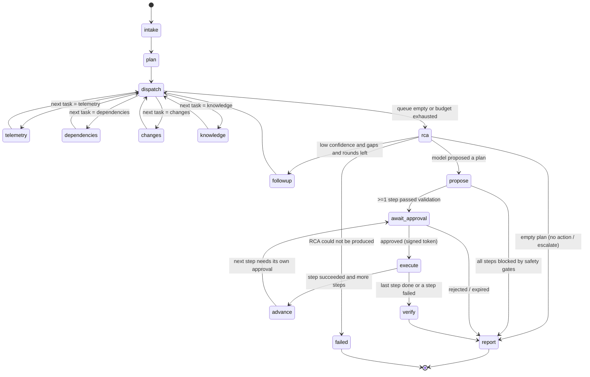

# Agent Workflows

The investigation is a LangGraph `StateGraph` compiled with `AsyncPostgresSaver`.
Implementation: `packages/agents/opspilot_agents/graph.py`.

## Graph

## Agents and responsibilities

| Node | Role | LLM? | Tools |
|---|---|---|---|
| `intake` | Load incident, establish time window | no | `get_incident` |
| `plan` | **Supervisor**: classify incident, choose capabilities and order | yes (1 call) | — |
| `dispatch` | Router: pop next task from queue; enforce budgets | no | — |
| `telemetry` | **Telemetry agent**: discovers the service's metrics, unit-aware bidirectional shift detection (with recovered flag), log clustering, health; records tool outages as evidence gaps | no | `list_service_metrics`, `query_metrics`, `search_logs`, `get_service_health` |
| `changes` | **Change agent**: deployments/config changes, temporal correlation scoring | no | `list_recent_deployments`, `get_config_changes` |
| `dependencies` | Runtime config, downstream health, datastore capacity, queue state | no | `get_service_dependencies`, `get_service_config`, `get_service_health`, `get_datastore_status`, `inspect_queue` |
| `knowledge` | **Knowledge agent**: hybrid retrieval over runbooks and past incidents, cited chunks | no | `search_runbooks`, `get_historical_incidents` |
| `rca` | **RCA agent**: ranked hypotheses, evidence gaps, follow-ups, remediation choice | yes (1 call per round) | — |
| `followup` | Translate LLM-requested follow-ups into queued tasks (bounded rounds) | no | — |
| `propose` | Validate each plan step against evidence and safety gates; canonical order; derive stable action IDs | no | — |
| `await_approval` | `interrupt()` with the exact action; validate the resume payload | no | — |
| `execute` / `advance` | Execute one approved step; advance to the next step (which needs its own approval) | no | `execute_remediation` (action server) |
| `verify` | Every required recovery condition in the observed scope passes (see "Recovery verification") | no | `query_metrics`, `get_service_health`, postcondition reads |
| `report` | Deterministic outcome + escalation; render RCA markdown from state | no | — |

Deterministic analysis runs as plain code — the LLM is used where judgement is needed
(classification/planning and hypothesis ranking/remediation choice), not to re-describe numbers.

## Evidence-driven routing (not a fixed sequence)

The supervisor's plan seeds a task queue (which capabilities run). Two capabilities are policy-mandated
and recorded in `plan.notes` when the model omits them: `telemetry` on the alerting service, and
`knowledge` (hypotheses must be grounded in retrieved runbooks/incidents — added after the evaluation
showed the model sometimes dropping it). `dispatch` schedules queued tasks by data dependency —
telemetry → dependencies → changes → knowledge — because each consumes what the previous found
(onset time → related services → change correlation → informed retrieval queries).

Nodes may **append** tasks based on what they found:

- `telemetry` on the affected service finds error signatures naming a downstream dependency
  (e.g. `ledger`, `relation`, `connection pool`) → enqueue `dependencies`.
- `changes` finds a high-correlation change on a *different* service than the one under
  investigation → enqueue `telemetry` scoped to that service.
- `rca` returns `followups` (enum) with confidence below `RCA_CONFIDENCE_THRESHOLD`
  → `followup` enqueues those capabilities, at most `MAX_INVESTIGATION_ROUNDS` times.

Tasks are de-duplicated by `(capability, service)` so the graph cannot loop on the same work.

## State

`InvestigationState` (`state.py`) is a `TypedDict` of JSON-compatible values so checkpoints
deserialize under `LANGGRAPH_STRICT_MSGPACK=true`. Pydantic models in
`opspilot_shared.domain` validate every value on the way in and out of nodes.

| Key | Reducer | Contents |
|---|---|---|
| `incident` | replace | incident snapshot |
| `window` | replace | analysis window (start/end/onset) |
| `classification`, `plan` | replace | supervisor output |
| `task_queue`, `completed_tasks` | replace | routing state |
| `evidence` | merge by ID | `Evidence` items |
| `observations` | append | agent findings referencing evidence IDs |
| `tool_calls`, `llm_calls` | append | invocation records (latency, status, tokens) |
| `hypotheses`, `rca` | replace | RCA output after validation |
| `proposed_action`, `approval` | replace | remediation lifecycle |
| `remediation_result`, `verification` | replace | outcome |
| `budget` | replace | counters vs limits |
| `status`, `errors` | replace / append | lifecycle + structured errors |

## Bounds and policies

| Policy | Default | Setting |
|---|---|---|
| Max tool calls per investigation | 40 | `AGENT_MAX_TOOL_CALLS` |
| Max LLM calls per investigation | 6 | `AGENT_MAX_LLM_CALLS` |
| Max RCA rounds | 2 | `AGENT_MAX_ROUNDS` |
| Tool timeout | 20 s | `TOOL_TIMEOUT_SECONDS` |
| LLM timeout | 180 s | `LLM_TIMEOUT_SECONDS` |
| Node retry | 2 attempts on transient errors | LangGraph `RetryPolicy` |
| LLM structured-output retries | 2 | `LLM_MAX_RETRIES` |

## Human-in-the-loop

`await_approval` calls `interrupt(payload)` where payload carries the action ID, type,
parameters and parameter hash. LangGraph re-executes the node on resume, so the node is
side-effect free; persistence of the action request happens in the runner (idempotent upsert), which also writes the
partial result (classification, plan, RCA, proposal) so the reviewer sees the hypotheses before deciding.
The resume value must reference the same action ID and parameter hash or the node raises
`ApprovalMismatch`, failing closed.

## Durability

- Thread ID = investigation ID. Checkpoints are written after every super-step.
- Decisions are delivered through a transactional outbox (`ops.workflow_commands`, written in the decision's
  transaction) by a claim-based dispatcher. Delivery is at least once; exactly-once *effects* come from
  idempotency. The approval token is minted at delivery and never stored. Start-up reconciliation and a 15 s
  sweep redeliver, finalise or interrupt runs whose process died (C0 H3).
- Execution ownership is a DB lease (`run_owner`, `run_lease_until`) renewed while a segment runs, so two API
  processes cannot run one workflow. A resume command re-checks the pause after taking the lease (C0 G).
- **Lease fencing (C0-F2).** A renewal that finds another owner (or cannot renew before expiry) cancels the
  segment; every runner write re-checks ownership under a row lock, so a stale owner that resumes after a
  takeover records nothing. The checkpointer's own writes are not fenced; effects stay idempotent per action ID.
- **Atomic admission (C0-F2).** `start` reserves an admission slot synchronously before writing, creates the row
  with this process's lease, and hands the reservation to `submit` (no second capacity check). A refused start
  writes nothing; a failed transaction releases its slot; in-process duplicate starts are single-flighted (409).
  Accepted work whose dispatch failed, or whose process died before running it (`queued`, no checkpoint), is
  re-dispatched by the sweep once its lease has expired or was released (NULL leases are now swept). Runs that had
  started become `interrupted` for an explicit operator resume, as before. No DB transaction spans model inference.
- Restart: any run in a non-terminal state can be continued with `graph.ainvoke(None, config)`
  (exposed as `POST /api/v1/investigations/{id}/resume`).
- `tests/integration/test_checkpoint_resume.py` builds a graph, runs it to the interrupt, discards
  the graph and the connection pool, rebuilds both, and resumes from Postgres.

## Remediation plans and safety gates

The RCA model returns an ordered plan of 0–4 catalogue steps. `propose` admits a step only if it passes
generic, evidence-based rules (`packages/agents/opspilot_agents/remediation.py`); none of them names a
scenario:

| Gate | Rule |
|---|---|
| Impact | Tri-state and computed, not model-reported (C0 H2). `ongoing` needs affirmative evidence (an unrecovered anomaly, or unhealthy status). `recovered` needs complete core metrics with ≥ 20 points and healthy status. Anything missing, failed, insufficient or conflicting is `unknown`, which blocks proposals (`insufficient_evidence`) |
| Evidence | Deployment IDs, services, queues and error codes must appear in collected evidence |
| Correlation | A rollback target must correlate with the onset (≥ 0.3) |
| Ambiguity | Refuse a rollback when another change is within 0.15 correlation (≥ 0.5): a human must discriminate |
| Causal consistency | Refuse reverting X when ≥ 80% of X's errors blame a different, unhealthy, unchanged dependency |
| Capacity | Pool changes must keep replicas × pool + other clients ≤ 90% of usable datastore connections, ≤ 2× per step, and capacity evidence must exist |
| Abnormality | Restart / pause targets must themselves show abnormal evidence |
| Shape | Canonical containment → resolution → recovery; restart/pool-scale dropped when the plan reverts the cause; a paused consumer is always resumed (policy-added step, separately approved) |

Rejected steps are recorded with a category (`invalid`, `unsafe`, `insufficient_evidence`, `unwarranted`,
`withheld_uncertain`).

### Uncertainty policy (C0 F)

After the gates, a valid plan is **withheld** (`withheld_uncertain`) when:
- no hypothesis exists;
- the top confidence is below `confidence_threshold` (0.6);
- the RCA requests escalation;
- the top two hypotheses are within `ambiguity_margin` (0.1) and share no supporting evidence;
- a tool or model budget was exhausted.

An explicit escalation yields `escalated`; any other withheld plan yields `inconclusive`. There is no operator
override in this phase.

## Recovery verification (C0 H4, C0-F1)

Invariant: an incident is never `mitigated` while a known required recovery condition is failed, unknown or
unverified. `verify` enumerates *every* required condition first, then checks them or reports `not_checked`
against an explicit budget (`max_verification_checks`, default 16, and the remaining tool budget). The result is
`recovered`, `not_recovered` or `incomplete`; `determine_outcome` re-checks the invariant (every required
condition has a passed check) before it reports `mitigated`.

- **Scope (C0-F1)** is derived from the observed incident, recorded per service with its reasons:
  the alerting service; every executed step's target (and the consumer of a quarantined queue); every
  dependency observed unhealthy/degraded on a call path from a service in scope (transitively); and services the
  top hypothesis cites. Citations can only add services. Every anomaly outside the scope is listed in `excluded`
  with a machine-readable reason.
- **Metric conditions:** every in-scope unrecovered anomaly that moved in its metric's unhealthy direction.
  - The acceptable range is a quarter of the excursion, capped by a metric-specific residual limit (e.g. 5xx
    ratio ≤ baseline + 1 point; p95 ≤ baseline + max(100 ms, 50%)), so "improved" is not "recovered".
  - Higher-is-bad metrics pass below baseline; lower-is-bad metrics may overshoot (a backlog drain is healthy).
  - Unknown metrics use a two-sided band and fail on opposite-direction excursions.
  - Load and config metrics are informational only.
- **Health conditions (C0-F1):** an in-scope service observed unhealthy/degraded before the action must be
  observed `healthy` after it. Unhealthy afterwards fails (also when its metrics look quiet); missing or stale
  (older than the action) health is `unknown`.
- **Postconditions:** rollback applied, pool size applied, no unquarantined failing messages, consumer running.
- Each check links to its anomaly/health evidence and its tool call; missing telemetry is `unknown`, never passed.

## Outcomes

`report` classifies every run deterministically: `mitigated`, `not_recovered`, `verification_incomplete`,
`remediation_failed`, `remediation_rejected`, `approval_expired`, `no_action_required`, `impact_unknown`,
`proposal_blocked`, `escalated`, `inconclusive`, `no_action_proposed`, `failed`. An explicit escalation request
always takes precedence over `no_action_required`. All except `mitigated` and `no_action_required` set
`escalate=true` and render an Escalation section. The incident becomes `mitigated` / `resolved` /
stays `open` accordingly.

## Resilience

- MCP sessions are owned by a supervisor task (`SupervisedMcpGateway`): transport failures trigger bounded
  reconnection with backoff and one retry of the call (safe: reads are idempotent, execution is idempotent per
  action ID); exhaustion fails fast and readiness turns red.
- Approval requests expire (`APPROVAL_REQUEST_TTL_SECONDS`): refused at decision time and swept every 60 s;
  the run resumes into the report with outcome `approval_expired`.
