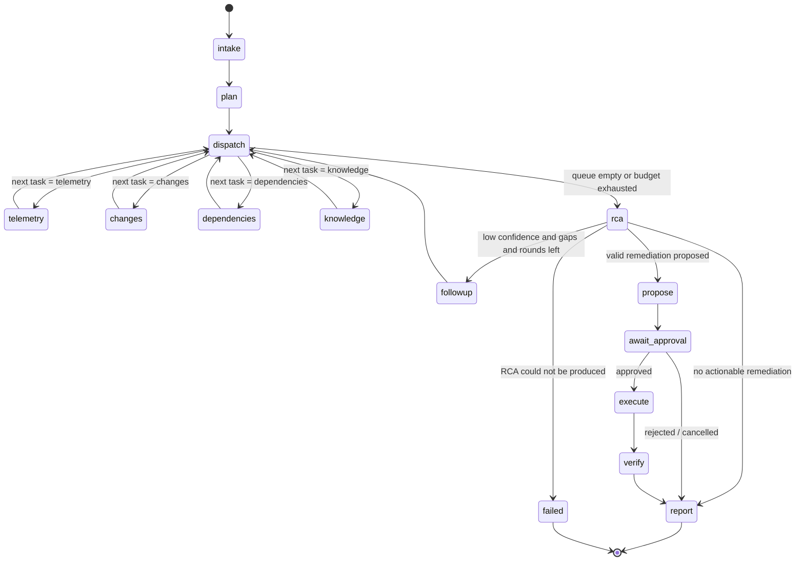

# Agent Workflows

The investigation is a LangGraph `StateGraph` compiled with `AsyncPostgresSaver`.
Implementation: `packages/agents/opspilot_agents/graph.py`.

## Graph

## Agents and responsibilities

| Node | Role | LLM? | Tools |
|---|---|---|---|
| `intake` | Load incident, establish time window | no | `get_incident` |
| `plan` | **Supervisor**: classify incident, choose capabilities and order | yes (1 call) | — |
| `dispatch` | Router: pop next task from queue; enforce budgets | no | — |
| `telemetry` | **Telemetry agent**: error-rate anomaly + onset detection, log signature clustering, health | no | `query_metrics`, `search_logs`, `get_service_health` |
| `changes` | **Change agent**: deployments/config changes, temporal correlation scoring | no | `list_recent_deployments`, `get_config_changes` |
| `dependencies` | Downstream health and error rates | no | `get_service_dependencies`, `get_service_health`, `query_metrics` |
| `knowledge` | **Knowledge agent**: hybrid retrieval over runbooks and past incidents, cited chunks | no | `search_runbooks`, `get_historical_incidents` |
| `rca` | **RCA agent**: ranked hypotheses, evidence gaps, follow-ups, remediation choice | yes (1 call per round) | — |
| `followup` | Translate LLM-requested follow-ups into queued tasks (bounded rounds) | no | — |
| `propose` | Validate remediation against the catalogue and evidence; derive stable action ID | no | — |
| `await_approval` | `interrupt()` with the exact action; validate the resume payload | no | — |
| `execute` | Call approval-gated sandbox action | no | `execute_remediation` (action server) |
| `verify` | Compare post-action error rate against SLO threshold | no | `query_metrics`, `get_service_health` |
| `report` | Render RCA markdown + structured result from state | no | — |

Deterministic analysis runs as plain code — the LLM is used where judgement is needed
(classification/planning and hypothesis ranking/remediation choice), not to re-describe numbers.

## Evidence-driven routing (not a fixed sequence)

The supervisor's plan seeds a task queue (which capabilities run). Two capabilities are policy-mandated
and recorded in `plan.notes` when the model omits them: `telemetry` on the alerting service, and
`knowledge` (hypotheses must be grounded in retrieved runbooks/incidents — added after the evaluation
showed the model sometimes dropping it). `dispatch` schedules queued tasks by data dependency —
telemetry → dependencies → changes → knowledge — because each consumes what the previous found
(onset time → related services → change correlation → informed retrieval queries).

Nodes may **append** tasks based on what they found:

- `telemetry` on the affected service finds error signatures naming a downstream dependency
  (e.g. `ledger`, `relation`, `connection pool`) → enqueue `dependencies`.
- `changes` finds a high-correlation change on a *different* service than the one under
  investigation → enqueue `telemetry` scoped to that service.
- `rca` returns `followups` (enum) with confidence below `RCA_CONFIDENCE_THRESHOLD`
  → `followup` enqueues those capabilities, at most `MAX_INVESTIGATION_ROUNDS` times.

Tasks are de-duplicated by `(capability, service)` so the graph cannot loop on the same work.

## State

`InvestigationState` (`state.py`) is a `TypedDict` of JSON-compatible values so checkpoints
deserialize under `LANGGRAPH_STRICT_MSGPACK=true`. Pydantic models in
`opspilot_shared.domain` validate every value on the way in and out of nodes.

| Key | Reducer | Contents |
|---|---|---|
| `incident` | replace | incident snapshot |
| `window` | replace | analysis window (start/end/onset) |
| `classification`, `plan` | replace | supervisor output |
| `task_queue`, `completed_tasks` | replace | routing state |
| `evidence` | merge by ID | `Evidence` items |
| `observations` | append | agent findings referencing evidence IDs |
| `tool_calls`, `llm_calls` | append | invocation records (latency, status, tokens) |
| `hypotheses`, `rca` | replace | RCA output after validation |
| `proposed_action`, `approval` | replace | remediation lifecycle |
| `remediation_result`, `verification` | replace | outcome |
| `budget` | replace | counters vs limits |
| `status`, `errors` | replace / append | lifecycle + structured errors |

## Bounds and policies

| Policy | Default | Setting |
|---|---|---|
| Max tool calls per investigation | 40 | `AGENT_MAX_TOOL_CALLS` |
| Max LLM calls per investigation | 6 | `AGENT_MAX_LLM_CALLS` |
| Max RCA rounds | 2 | `AGENT_MAX_ROUNDS` |
| Tool timeout | 20 s | `TOOL_TIMEOUT_SECONDS` |
| LLM timeout | 180 s | `LLM_TIMEOUT_SECONDS` |
| Node retry | 2 attempts on transient errors | LangGraph `RetryPolicy` |
| LLM structured-output retries | 2 | `LLM_MAX_RETRIES` |

## Human-in-the-loop

`await_approval` calls `interrupt(payload)` where payload carries the action ID, type,
parameters and parameter hash. LangGraph re-executes the node on resume, so the node is
side-effect free; persistence of the action request happens in the runner (idempotent upsert), which also writes the
partial result (classification, plan, RCA, proposal) so the reviewer sees the hypotheses before deciding.
The resume value must reference the same action ID and parameter hash or the node raises
`ApprovalMismatch`, failing closed.

## Durability

- Thread ID = investigation ID. Checkpoints are written after every super-step.
- Restart: any run in a non-terminal state can be continued with `graph.ainvoke(None, config)`
  (exposed as `POST /api/v1/investigations/{id}/resume`).
- `tests/integration/test_checkpoint_resume.py` builds a graph, runs it to the interrupt, discards
  the graph and the connection pool, rebuilds both, and resumes from Postgres.
