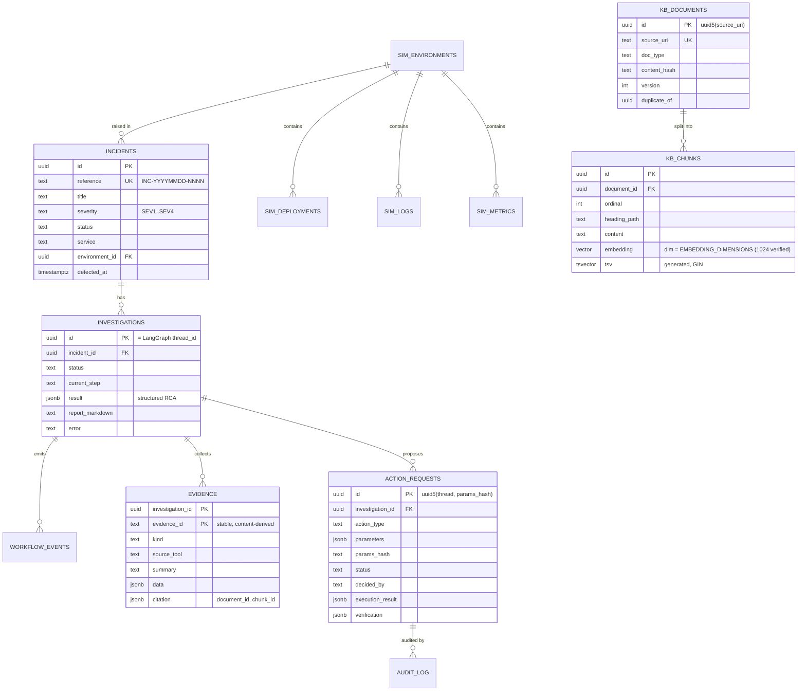

# Data Model

One PostgreSQL 17 database (`opspilot`) with four schemas. ORM models:
`packages/shared/opspilot_shared/db/models.py`. Migrations: `infra/db/migrations` (Alembic),
except `langgraph.*`, which is owned and migrated by `langgraph-checkpoint-postgres`'s `setup()`
(invoked by `make migrate`, never on application start-up).

| Schema | Owner (single writer) | Purpose |
|---|---|---|
| `ops` | API | incidents, investigations, evidence, workflow events, action requests, audit log |
| `kb` | RAG ingestion | documents, chunks (+ embeddings, tsvector), ingestion runs, retrieval traces |
| `sim` | Simulator (+ action server via simulator API) | synthetic environment: services, dependencies, deployments, config changes, logs, metrics |
| `langgraph` | LangGraph checkpointer | checkpoints, blobs, writes, checkpointer migrations |

## Status enumerations

- Incident: `open → investigating → awaiting_approval → mitigated | resolved`, or `open` again on failure.
- Investigation: `queued → running → awaiting_approval → running → completed | failed | cancelled`.
- Action request: `pending → approved → executing → succeeded | failed`, or `pending → rejected | cancelled`.
  Transitions are guarded by conditional `UPDATE … WHERE status = :expected RETURNING`,
  which makes approval and execution idempotent and race-safe.

## Indexes

- `kb.chunks.embedding` — HNSW (`vector_cosine_ops`).
- `kb.chunks.tsv` — GIN; `tsv` is a generated column over title + heading path + content.
- `sim.logs (environment_id, service, ts)`, `sim.logs.tsv` GIN, `sim.metrics (environment_id, service, name, ts)`.
- `ops.workflow_events (investigation_id, id)`, `ops.action_requests (status)`.

## Ground truth isolation

Scenario answer keys are **not** stored in the database. `sim.environments` stores only the scenario
key and seed needed to regenerate data. Ground truth lives in
`datasets/evaluation/ground_truth/*.json` and is read only by the evaluation package.
