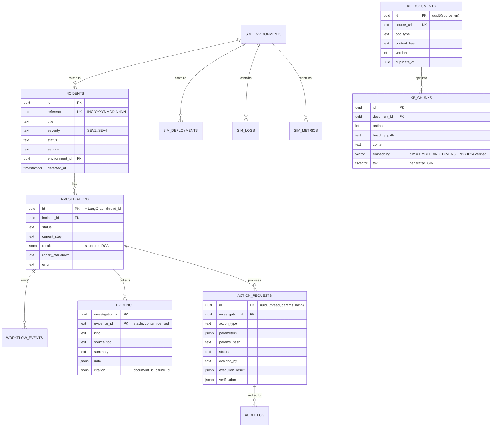

# Data Model

One PostgreSQL 17 database (`opspilot`) with four schemas. ORM models:
`packages/shared/opspilot_shared/db/models.py`. Migrations: `infra/db/migrations` (Alembic),
except `langgraph.*`, which is owned and migrated by `langgraph-checkpoint-postgres`'s `setup()`
(invoked by `make migrate`, never on application start-up).

| Schema | Owner (single writer) | Purpose |
|---|---|---|
| `ops` | API (one exception: the action server writes `action_requests.status` for the execution claim, C0 H) | incidents, investigations, evidence, workflow events, action requests, outbox, audit log |
| `kb` | RAG ingestion | documents, chunks (+ embeddings, tsvector), ingestion runs, retrieval traces |
| `sim` | Simulator (+ action server via simulator API) | synthetic environment: services, dependencies, deployments, config changes, logs, metrics |
| `langgraph` | LangGraph checkpointer | checkpoints, blobs, writes, checkpointer migrations |

## Status enumerations

- Incident: `open → investigating → awaiting_approval → mitigated | resolved`, or `open` again on failure.
- Investigation: `queued → running → awaiting_approval → running → completed | failed | cancelled`.
- Action request: `pending → approved → executing → succeeded | failed`, or `pending → rejected | cancelled`.
  Transitions are guarded by conditional `UPDATE … WHERE status = :expected RETURNING`,
  which makes approval and execution idempotent and race-safe.

## Indexes

- `kb.chunks.embedding` — HNSW (`vector_cosine_ops`).
- `kb.chunks.tsv` — GIN; `tsv` is a generated column over title + heading path + content.
- `sim.logs (environment_id, service, ts)`, `sim.logs.tsv` GIN, `sim.metrics (environment_id, service, name, ts)`.
- `ops.workflow_events (investigation_id, id)`, `ops.action_requests (status)`.
- `uq_ops_investigations_one_active_per_incident`: a partial **unique** index on `ops.investigations (incident_id)`
  where the status is queued, running, awaiting_approval or interrupted. At most one active investigation per
  incident (migration 0005, C0 G).
- `ops.workflow_commands`: unique `action_id`, plus `(status, claimed_at)` for the outbox dispatcher (migration
  0004, C0 H3).
- `trg_ops_investigations_terminal_guard` (migration 0006, C0-G2): a `BEFORE UPDATE OF status` trigger that refuses
  any status change out of `completed` or `cancelled`.

## Execution ownership and outbox (Phase C0)

- `ops.investigations.run_owner` / `run_lease_until`: the API process currently running a graph segment and its
  lease expiry, claimed by compare-and-set and renewed while running.
- `ops.workflow_commands`: the durable decision-delivery outbox (`pending → delivering → delivered | failed`, and
  `pending | delivering → cancelled` in a cancellation's transaction, C0-G2), written in the decision's transaction.
  Approval tokens are never stored.
- Investigation status changes only through `repositories.transition_investigation` (locked compare-and-set against
  `domain.investigation.LEGAL_TRANSITIONS`, C0-G2).
- Execution owner (C0-G4): not a table. A session-level advisory lock `(0x4F505350, 1)` per database, held by the one
  runtime that may execute investigations; visible in `pg_locks` with the owner's `application_name`.

## Database roles

| Role | Used by | Rights |
|---|---|---|
| `opspilot_app` | API, migrations, ingestion | owner of all application schemas |
| `opspilot_mcp_read` | MCP read server | SELECT on `sim.*`, `kb.*`, `ops.incidents`; INSERT on `kb.retrieval_queries` |
| `opspilot_mcp_actions` | MCP action server | SELECT/INSERT/UPDATE on `sim.*` (no DELETE); SELECT on `ops.action_requests`; UPDATE of `ops.action_requests.status` only (the execution claim) |

Provisioned by `scripts/db-roles.sh` (`make db-roles`, also run by bootstrap); idempotent and additive. Without
role passwords in `.env`, the MCP children fall back to `opspilot_app`.

## Ground truth isolation

Scenario answer keys are **not** stored in the database. `sim.environments` stores only the scenario
key and seed needed to regenerate data. Ground truth lives in
`datasets/evaluation/ground_truth/*.json` and is read only by the evaluation package.
