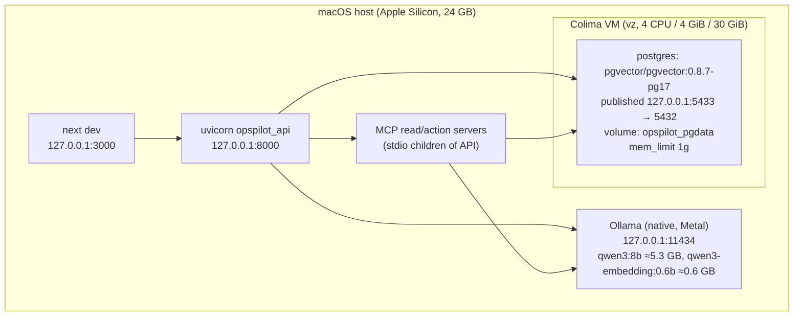

# Deployment (local-first)

## Single execution owner per database (C0-G4)

**Exactly one API worker per database.** Admission, the in-process task registry and LangGraph's checkpoint writes
are process-local, so OpsPilot enforces a single execution owner at runtime rather than by convention:

- Every runtime (API worker, `opspilot investigate`/demo, `opspilot-eval`) first takes a PostgreSQL session-level
  advisory lock in its database. A second one fails at start-up with `execution_owner_unavailable`, naming the holder.
  With `uvicorn --workers 2` one worker acquires, the other is refused and Uvicorn stops the server.
- `scripts/start.sh` and `scripts/e2e-api.sh` pin `--workers 1` and unset `WEB_CONCURRENCY`; an API started with
  `WEB_CONCURRENCY>1` refuses to start.
- The lock is per database: the dev API (`opspilot`) and tests/E2E (`opspilot_test`) never contend. Python tests and
  the E2E stack share `opspilot_test`, so they cannot run at the same time (the second refuses to start).
- Stop the dev API (`make stop`) before `make evaluate` or the CLI demo against the dev database.
- Graceful shutdown releases it; a crash or `kill -9` releases it automatically (PostgreSQL ends the session). Start-up
  waits up to `EXECUTION_OWNER_ACQUIRE_TIMEOUT_SECONDS` (10 s) for a previous owner, which covers `--reload`.
- A watchdog probes the lock every `EXECUTION_OWNER_CHECK_SECONDS` (5 s). On connection loss the process stops all
  execution (running segments are recorded `interrupted` when possible; new work gets 503) and the served API exits,
  so it never continues as an unprotected owner. `/health/ready` reports `execution_owner`.
- No transaction is held by the lock connection (autocommit), and none spans inference.

- **Runtime lifecycle (C0-H2):** `INITIALIZING → ACQUIRING_OWNERSHIP → READY → OWNERSHIP_LOST → STOPPING → STOPPED`.
  Only READY admits or runs investigations, reconciles, delivers decisions or sweeps. READY is entered after
  initialization and an affirmative database fence check; loss before it fails start-up, loss after it stops all
  execution synchronously and the API exits.
- **Write fencing (C0-H2):** each new owner increments `ops.execution_owner.epoch`; checkpoint writes (database trigger),
  runner state writes and remediation claims carry the owner's `(epoch, lock pid)` and are refused once the owner is
  stale or its lock session is gone. A takeover waits for in-flight fenced writes, so for these writes the old and new
  owners never interleave. **Scope:** the fence covers normal application writes and the unprivileged MCP roles. The
  application role `opspilot_app` owns the epoch and checkpoint tables, so it is a trusted schema administrator that
  could disable the triggers; the fence is not tamper-proof against that credential. Operator control-plane writes
  (start, cancel, decide) are not fenced: a process that has just lost ownership can still commit them, and they are
  picked up by the new owner after lease/outbox recovery (up to the run lease of 60 s or the command lease of 120 s,
  plus sweep timing). Independent verification found delay but no stale execution.
- **Upgrades:** stop the API before `make migrate` when upgrading to 0008 — the new checkpoint trigger refuses writes from
  a running pre-0008 API (by design). Then `make db-roles` (grants the fence to the action role) and `make dev`.

Multi-worker execution (global admission) is not supported in v0.2.1.

## Why this shape

- Ollama runs **natively** — containers on macOS cannot use the Metal GPU.
- Only PostgreSQL is containerised. It is the single stateful dependency, and a pinned image
  (`pgvector/pgvector:0.8.7-pg17`) makes the extension version reproducible.
- Every listener binds to `127.0.0.1`.

## Memory budget (measured 2026-11-04, during an investigation)

| Component | Measured |
|---|---|
| qwen3:8b loaded (`ollama ps`, num_ctx 8192) | 5.2 GB |
| qwen3-embedding:0.6b loaded | 1.0 GB |
| Postgres container (`docker stats`; limit 1 GiB) | 277 MB |
| Colima VM ceiling | 4 GiB (allocation, not usage) |
| API + 2 MCP children + Next.js dev (RSS) | ~230 MB |
| **Working set** | **≈ 6.7 GB** + VM overhead; system reported 29% memory free with IDE/browser open |

Both models stay resident under `LLM_KEEP_ALIVE=10m`; `OLLAMA_MAX_LOADED_MODELS` was left at its default.

### Resource limits (Phase C0)

| Setting | Default | Bound |
|---|---|---|
| `LLM_MAX_CONCURRENCY` | 1 | in-flight chat requests per process |
| `EMBEDDING_MAX_CONCURRENCY` | 2 | in-flight `/api/embed` requests per process (API and each MCP child) |
| `MAX_CONCURRENT_INVESTIGATIONS` | 1 | graph segments running at once |
| `MAX_PENDING_INVESTIGATIONS` | 4 | segments running + waiting; beyond it new work gets HTTP 429 before anything is written |

`make evaluate` measures embedding bursts, a chat call and Ollama's resident memory on this machine; see
"Resources on this machine" in `docs/evaluation/BASELINE.md`.

## Disk budget

| Item | Size |
|---|---|
| Models (`~/.ollama/models`) | 5.5 GB (measured) |
| Colima VM disk (sparse, 30 GiB cap) | 2.2 GB (measured; image 646 MB, data volume 440 MB) |
| Python venv / node_modules | 0.23 GB / 0.76 GB (measured) |
| **Project total** | **≈ 8.7 GB**, well under the 50 GB target |

## Compose profiles

| Profile | Services | Default |
|---|---|---|
| *(none)* | `postgres` | yes |
| `observability` | `jaegertracing/jaeger:2.21.0` (OTLP on 127.0.0.1:4317/4318, UI 16686, mem_limit 512m) | no |
| `tools` | `adminer:6.3.0` (127.0.0.1:8081, mem_limit 128m) | no |

Start optional profiles explicitly, e.g. `make infra-up PROFILES=observability`.

## Lifecycle commands

| Command | Effect |
|---|---|
| `make infra-up` | start Colima if stopped, `docker-compose up -d postgres`, wait for health |
| `make migrate` | Alembic upgrade + LangGraph checkpointer `setup()` (0006 adds the terminal-investigation trigger, C0-G2) |
| `make db-roles` | create/refresh the least-privilege MCP database roles (idempotent, additive; bootstrap runs it) |
| `make dev` | start API (one worker, C0-G4) and web (skips any already listening) |
| `make e2e` | isolated E2E stack: API :8100 forced onto `opspilot_test`, web :3100 with its own build dir; identity verified before any mutation; can run beside `make dev` |
| `make stop` / `make infra-down` | stop app processes / stop containers (**volumes preserved**) |

Nothing in the tooling runs `docker system prune`, `docker volume prune` or deletes volumes.
