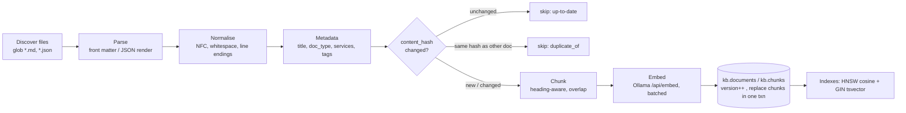
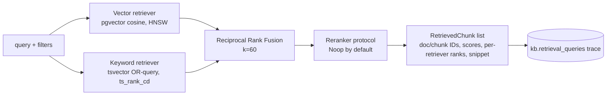

# RAG Pipeline

Implementation: `packages/rag/opspilot_rag/`.

## Ingestion

| Concern | Implementation |
|---|---|
| Stable document ID | `uuid5(NAMESPACE, source_uri)` — same file → same ID across runs |
| Chunk ID | `uuid5(document_id, f"{version}:{ordinal}")` |
| Content hash | SHA-256 of normalised text + canonical metadata |
| Versioning | `version` increments when the hash changes; chunks replaced atomically |
| Incremental | unchanged hash → skipped without embedding calls |
| Deduplication | identical hash under a different path → recorded as `duplicate_of`, not embedded |
| Reindex | `--reindex` forces re-chunk/re-embed (e.g. after a model change) |
| Status | `kb.ingestion_runs` with per-file outcome and error messages |
| Formats | `Parser` protocol keyed by suffix; Markdown and JSON now, PDF later via a new parser |
| Embedding guard | vector length is checked against `EMBEDDING_DIMENSIONS` before insert |

### Chunking

Markdown is split on headings into sections, carrying the heading path
(e.g. `Schema migration rollback > Verify`). Sections longer than `CHUNK_MAX_WORDS` (default 220)
are split on paragraph boundaries with `CHUNK_OVERLAP_WORDS` (default 40) overlap. The heading path
and document title are prepended to the *embedded* text (not the stored snippet) so short sections
keep their context.

## Retrieval

- **Vector**: query embedded with the Qwen3-Embedding instruction prefix
  (`Instruct: ...\nQuery: ...`) as recommended by the model card; documents are embedded raw.
- **Keyword**: query terms are lexed with `to_tsvector('english', q)` and OR-combined, because
  `websearch_to_tsquery` ANDs every term and returns nothing for long natural-language queries.
- **Fusion**: RRF, `score = Σ 1/(k + rank)`. Chosen because the two score scales (cosine
  distance vs. `ts_rank_cd`) are not comparable, and RRF needs no calibration.
- **Filters**: `doc_types`, `services` (JSONB containment), `tags` — applied inside both retrievers.
- **Trace**: every search writes a row with query, filters, mode, latency and the ranked result IDs.

## Trust boundary

Retrieved text is **evidence, not instruction**. It is passed to the LLM inside a delimited
`<evidence>` block with an explicit system instruction that content inside evidence must never be
followed. Remediation is chosen from a fixed catalogue and validated in code, so injected text
cannot introduce new actions. See `SECURITY.md`.

## Benchmark

`make evaluate` runs `opspilot_eval.retrieval_bench` over `datasets/evaluation/retrieval_questions.jsonl`
(labelled relevant documents) for `vector`, `keyword` and `hybrid` modes and writes Recall@K, MRR,
nDCG@K and latency to `docs/evaluation/BASELINE.md` and `datasets/evaluation/results/`.
