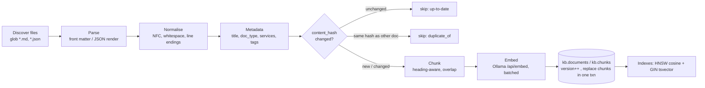
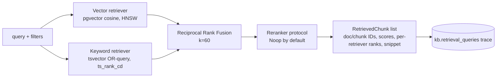

# RAG Pipeline

Implementation: `packages/rag/opspilot_rag/`.

## Ingestion

| Concern | Implementation |
|---|---|
| Stable document ID | `uuid5(NAMESPACE, source_uri)` — same file → same ID across runs |
| Chunk ID | `uuid5(document_id, f"{version}:{ordinal}")` |
| Content hash | SHA-256 of normalised text + canonical metadata |
| Versioning | `version` increments when the hash changes; chunks replaced atomically |
| Incremental | unchanged hash → skipped without embedding calls |
| Deduplication | identical hash under a different path → recorded as `duplicate_of`, not embedded |
| Reindex | `--reindex` forces re-chunk/re-embed (e.g. after a model change) |
| Status | `kb.ingestion_runs` with per-file outcome and error messages |
| Formats | `Parser` protocol keyed by suffix; Markdown and JSON now, PDF later via a new parser |
| Embedding guard | vector length is checked against `EMBEDDING_DIMENSIONS` before insert |

### Chunking

Markdown is split on headings into sections, carrying the heading path
(e.g. `Schema migration rollback > Verify`). Sections longer than `CHUNK_MAX_WORDS` (default 220)
are split on paragraph boundaries with `CHUNK_OVERLAP_WORDS` (default 40) overlap. The heading path
and document title are prepended to the *embedded* text (not the stored snippet) so short sections
keep their context.

## Retrieval

- **Vector**: query embedded with the Qwen3-Embedding instruction prefix
  (`Instruct: ...\nQuery: ...`) as recommended by the model card; documents are embedded raw.
- **Keyword**: query terms are lexed with `to_tsvector('english', q)` and OR-combined, because
  `websearch_to_tsquery` ANDs every term and returns nothing for long natural-language queries.
- **Fusion**: RRF, `score = Σ 1/(k + rank)`. Chosen because the two score scales (cosine
  distance vs. `ts_rank_cd`) are not comparable, and RRF needs no calibration.
- **Filters**: `doc_types`, `services` (JSONB containment), `tags` — applied inside both retrievers.
- **Lifecycle policy (C0 I):** applied to the fused candidates (top_k × 4) *before* truncation. It is a stable
  partition — `current` first, then `unreviewed` or unknown, then superseded / deprecated / retired / withdrawn /
  obsolete / archived — with score order kept within a tier. Results carry `metadata.lifecycle_tier`.
- **Normal investigation excludes obsolete guidance (C0-G3):** the agent-facing MCP tools (`search_runbooks`,
  `get_historical_incidents`) search with `exclude_obsolete=True`, so superseded/withdrawn documents are not
  candidates at all (filtered in the candidate statement). The authenticated operator API (`/knowledge/search`)
  keeps explicitly authorised historical search: obsolete documents are returned, labelled and ranked last. The
  knowledge node also withholds any obsolete passage that still arrives (`withheld_obsolete` in its observation).
- **Lifecycle consistency (C0-G3):** ranking, expansion and response assembly run in separate snapshots, so a
  lifecycle change can land in between. Expansion re-checks the document's lifecycle and *current* version on the
  very rows it expands (one statement) and expands nothing if they changed. Immediately before the response is
  assembled every returned document is revalidated against committed rows: a passage whose version no longer exists
  is dropped, labels are replaced by the committed status/tier (`lifecycle_validated: true`), obsolete passages are
  dropped under `exclude_obsolete`, and expansion is withdrawn if its document changed. Each case adds a warning.
- **Consistent logical revisions (C0-H1):** a revision is `(document id, version)`. Ingestion publishes one under a
  per-document transaction advisory lock, assigning `committed version + 1` from the row read under that lock (the
  commit is the linearization point; row update and chunk replacement become visible together). Migration 0007 makes the
  database enforce it: a deferred composite FK keeps every committed chunk on its document's current revision, and a
  trigger refuses a content change without a version increase. Each passage carries `document_hash`; expansion and the
  final revalidation require the exact committed revision (version and hash), and one document never appears with two
  revisions in a response. Passages are handed over as value snapshots validated at that final statement.
  **Scope (independent verification C0-H):** revision identity is *logical source-content* identity, not physical
  chunk identity. Re-indexing unchanged text with different chunk settings keeps the version and can reuse a chunk
  ID for a different slice of the same source. The database guards the document's version/hash and chunk
  membership, not chunk bytes, so a direct chunk `UPDATE` by the trusted owner role (`opspilot_app`) is not refused.
  Neither happens through supported ingestion or tools; the MCP roles have no knowledge-base write privileges.
- **Degradation (C0 M):** if embeddings fail, hybrid degrades to keyword-only. `warnings` and
  `effective_mode = keyword` are returned and carried across MCP to the agent.
- **Citation snapshots (C0 J):** each result carries the full chunk `content` and `content_sha256`. The agent
  stores the passage, its hash, the document version, the lifecycle status and the retrieval time in the
  evidence citation, so an RCA stays reconstructable after re-ingestion replaces the chunks.
- **Section coverage (C0-F3):** heading-aware chunking means top-k can select a runbook's symptom paragraph while
  its diagnostic, remediation and constraint sections rank poorly. With `expand_sections=N` (0–4; MCP
  `search_runbooks`), the retriever also returns, in `context`, up to N other sections of the **top-ranked current
  runbook/troubleshooting document at the same document version**, chosen by a generic section role (remediation >
  constraints > diagnostics > causes > symptoms > other, from heading or text) and returned in document order.
  Only one document; lifecycle tier 0 only (re-validated at expansion and before assembly, C0-G3); superseded,
  unreviewed and incident documents are never expanded;
  `results` and the lifecycle ranking are unchanged. The agent requests 4; each section becomes cited evidence
  (full passage snapshot) ranked just below its anchor, and the knowledge observation records the roles covered.
  Coverage is not proof of causality: the RCA must still justify any action, and the gates are unchanged.
- **Trace**: every search writes a row with query, filters, mode, latency and the ranked result IDs.

## Trust boundary

Retrieved text is **evidence, not instruction**. It is passed to the LLM inside a delimited
`<evidence>` block with an explicit system instruction that content inside evidence must never be
followed. Remediation is chosen from a fixed catalogue and validated in code, so injected text
cannot introduce new actions. See `SECURITY.md`.

## Benchmark

`make evaluate` runs `opspilot_eval.retrieval_bench` over `datasets/evaluation/retrieval_questions.jsonl`
(labelled relevant documents) for `vector`, `keyword` and `hybrid` modes and writes Recall@K, MRR,
nDCG@K and latency to `docs/evaluation/BASELINE.md` and `datasets/evaluation/results/`.
