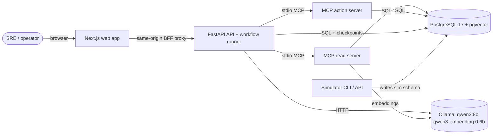

# OpsPilot AI — System Design

## 1. Purpose

OpsPilot AI investigates failures in distributed systems. Given an incident, it collects
telemetry, change history, dependency state and operational knowledge through typed tools,
correlates that evidence, produces ranked root-cause hypotheses with citations, proposes a
remediation from a fixed catalogue, **waits for a human to approve it**, executes it in a
sandbox, verifies recovery and writes an RCA report.

The first release runs entirely on one laptop against a deterministic simulator of a small
payment-like system. No paid API and no production access is needed.

## 2. Goals and non-goals

Goals

- Evidence-grounded RCA: every hypothesis cites evidence IDs that exist in the investigation.
- Durable, inspectable, bounded agent workflows that survive process restarts.
- Hybrid retrieval with measured (not claimed) quality.
- Backend-enforced human approval for every state-changing action.
- Local-first: native Ollama, one PostgreSQL, modest memory footprint.
- Clean seams so any part (model, retriever, tool backend, UI) can be replaced.

Non-goals (for now)

- Multi-tenant auth / SSO. The system is localhost-only; approval uses a shared operator token.
- Real infrastructure integrations. The tool layer is the seam where those would plug in.
- Streaming token output to the UI. Investigations are polled.

## 3. Context



## 4. Layering

Code is a single Python distribution split into top-level packages whose dependency direction
is enforced by `import-linter` (see `pyproject.toml`):

```
opspilot_api  ─────────────┐   presentation (FastAPI routes, DTOs) + application services
   │                       │
opspilot_agents            │   orchestration (LangGraph graph, nodes, policies)
   │                       │
opspilot_mcp ──► opspilot_rag, opspilot_simulator   tool adapters / knowledge / sandbox env
   │                       │
opspilot_shared ◄──────────┘   config, logging, tracing, domain types, ORM, LLM ports
opspilot_eval                  evaluation harness (may import anything; nothing imports it)
```

Rules

- `opspilot_agents` never imports Ollama, SQLAlchemy, FastAPI, the simulator or the RAG package.
  It depends on two ports: `ChatModel` (structured generation) and `ToolGateway` (typed tool calls).
- Route handlers only parse input, call an application service and map the result.
- `opspilot_simulator` is the only code that knows how faults are injected. Ground truth lives in
  `datasets/evaluation/` and is read only by `opspilot_eval`.
- `opspilot_shared.db` owns the ORM models for all schemas; each schema has one writer:
  `ops` → API, `kb` → RAG ingestion, `sim` → simulator (and the action server via simulator APIs).

## 5. Runtime processes

| Process | Started by | Purpose |
|---|---|---|
| Ollama | `brew services` (native) | LLM + embeddings, Metal GPU |
| PostgreSQL 17 + pgvector | Docker Compose (Colima) | all persistent state |
| FastAPI (uvicorn) | `make dev` | REST API, background investigation runner |
| MCP read server | child of API over stdio | read-only ops + knowledge tools |
| MCP action server | child of API over stdio | approval-gated sandbox remediation |
| Next.js | `make dev` | operator UI |

MCP servers run as stdio children by default so no extra port is opened. Both can also be served
over Streamable HTTP on 127.0.0.1 (`opspilot-mcp --transport streamable-http`) for use by other
MCP hosts.

## 6. Key flows

### 6.1 Investigation

1. `POST /api/v1/incidents/{id}/investigations` creates an `ops.investigations` row and returns
   `202` with the investigation ID (= LangGraph `thread_id`).
2. A bounded background runner (semaphore, default 1 concurrent investigation) streams the graph
   with the Postgres checkpointer, persisting workflow events, tool calls and evidence as each node
   completes.
3. The graph pauses at `await_approval` with a LangGraph `interrupt`. The runner persists the
   `ops.action_requests` row (idempotent on a deterministic action ID) and marks the investigation
   `awaiting_approval`.
4. The operator approves/rejects via the API. The API validates the token, the action's
   parameter hash, its status and that the workflow is paused on that exact action, then resumes
   the graph with `Command(resume=...)`.
5. On approval, the action node calls the MCP action server, which **independently** re-checks the
   approval in the database and atomically claims the action before executing it.
6. Verification re-queries telemetry; the report node renders the RCA from structured state.

See `AGENT_WORKFLOWS.md` for the graph.

### 6.2 Knowledge ingestion

Discover → parse → normalise → metadata → hash/dedup → chunk → embed → store → index.
See `RAG_PIPELINE.md`.

## 7. Cross-cutting concerns

- **Configuration**: one `Settings` object (`pydantic-settings`), env-driven, documented in `.env.example`.
- **Logging**: structlog JSON, with `correlation_id`, `incident_id`, `investigation_id`,
  `tool_call_id` bound via contextvars.
- **Tracing**: OpenTelemetry API spans around HTTP requests, graph nodes, tool and LLM calls.
  Exporter is `none` | `console` | `otlp` (OTLP is optional; no collector is required).
- **Built-in introspection**: `ops.workflow_events` (node, tool and LLM events with latency and
  token counts) and `kb.retrieval_queries` back the UI timeline without an external APM.
- **Resource limits**: LLM concurrency semaphore (default 1), bounded `num_ctx` / `num_predict`,
  tool-call and LLM-call budgets per investigation, timeouts on every external call.

## 8. Failure model

| Failure | Behaviour |
|---|---|
| Ollama down / timeout | LLM call retried (bounded); plan step falls back to "all capabilities" (recorded); RCA step fails the investigation with evidence retained. No heuristic RCA is substituted. |
| Tool error | Structured `is_error` result recorded as an evidence gap; transient errors retried by node retry policy. |
| Budget exhausted | Graph routes to RCA with what it has; budget exhaustion recorded. |
| API restart mid-run | Checkpoint persists; `POST /investigations/{id}/resume` continues from the last completed node. Paused (awaiting approval) runs survive untouched. |
| Invalid LLM output | Schema validation; fabricated evidence IDs are dropped and counted; out-of-catalogue remediations are rejected. |

## 9. Evolution path

- Replace the simulator-backed MCP server with real adapters (Prometheus, Loki, Tempo, Argo CD) —
  the agents only see the tool contracts.
- Swap the model via `LLM_MODEL` / provider; add a reranker behind the `Reranker` protocol.
- Move the runner to a worker process (the checkpointer already makes runs resumable anywhere).
- Add SSE for live timeline updates; OIDC for operator identity.
