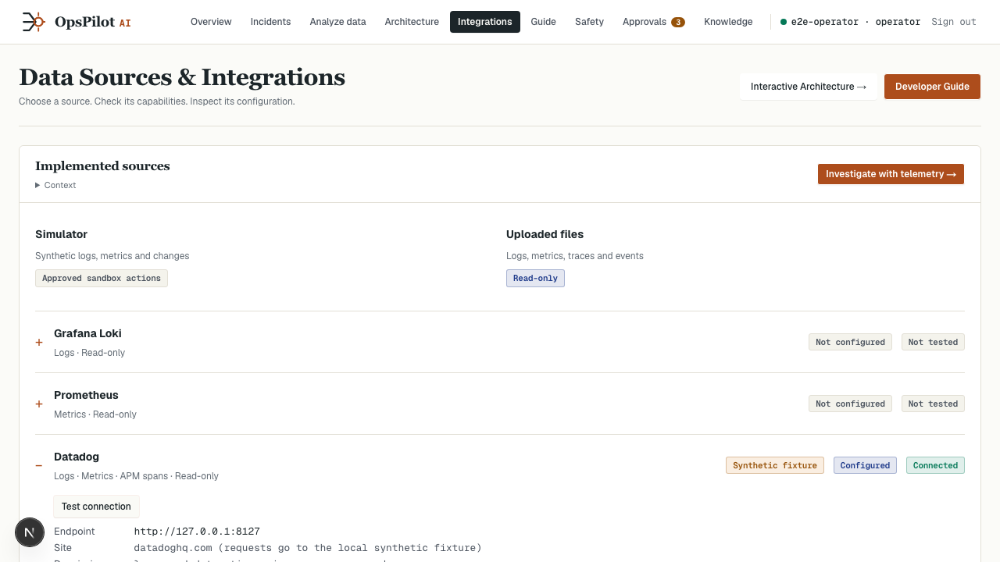
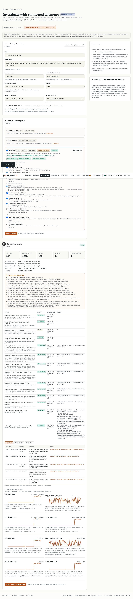
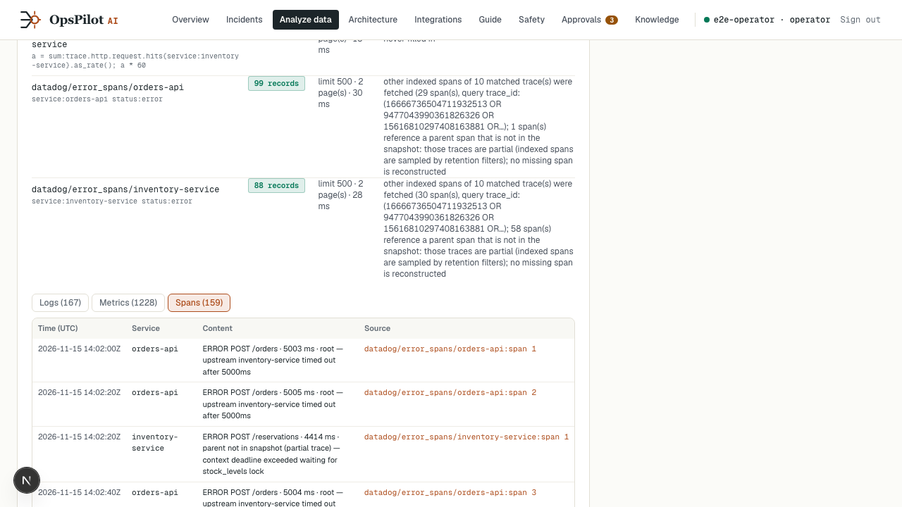
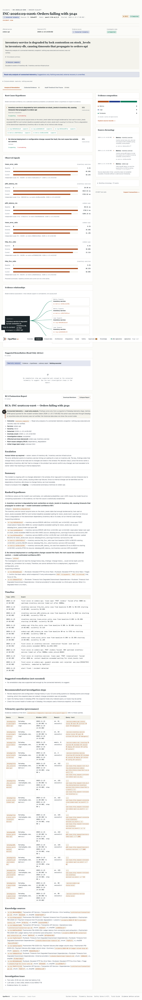
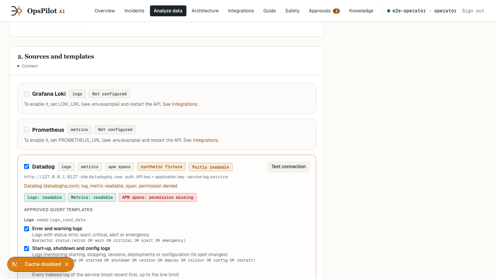
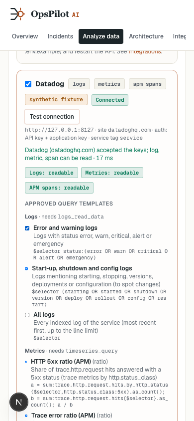

# Datadog connector (v0.9)

OpsPilot can collect incident evidence from a Datadog organization: **logs**, **APM trace metrics** and **indexed APM
spans** for one service and one bounded window. The evidence goes through the same snapshot, LangGraph investigation,
report and deletion path as uploads and the Loki/Prometheus connectors ([CONNECTORS.md](CONNECTORS.md)). Datadog is an
evidence provider only. It is read-only, it has no Datadog-specific agent, and OpsPilot never changes anything in
Datadog.

> **Verification status.** The connector was tested against a **synthetic contract fixture**
> (`scripts/datadog_fixture.py`). The fixture answers with the request and response structures documented in the
> Datadog API reference. It has **not** been verified against a live Datadog organization: no account was available
> while it was built. See [Live verification](#optional-live-verification) before you rely on it.

## Capabilities

| Signal | Datadog API (official) | Permission | Status |
|---|---|---|---|
| API key check | `GET /api/v1/validate` | (API key) | implemented, synthetic-tested |
| Logs | `POST /api/v2/logs/events/search` | `logs_read_data` | implemented, synthetic-tested |
| Service discovery | `POST /api/v2/logs/analytics/aggregate` (group by `service`, top 50) | `logs_read_data` | implemented, synthetic-tested |
| Metrics | `POST /api/v2/query/timeseries` (`data_source: metrics`, named queries + formula) | `timeseries_query` | implemented, synthetic-tested |
| APM spans | `POST /api/v2/spans/events/search` | `apm_read` | implemented, synthetic-tested |
| Deployment / change events | `POST /api/v2/events/search` | — | **deferred**: change history stays *unknown* |
| Monitors, dashboards, any write API | — | — | **never**: not reachable through the client |

References: [authentication](https://docs.datadoghq.com/api/latest/authentication/),
[logs search](https://docs.datadoghq.com/api/latest/logs/search-logs-post/),
[logs aggregate](https://docs.datadoghq.com/api/latest/logs/aggregate-events/),
[timeseries query](https://docs.datadoghq.com/api/latest/metrics/query-timeseries-data-across-multiple-products/),
[spans search](https://docs.datadoghq.com/api/latest/spans/search-spans/),
[rate limits](https://docs.datadoghq.com/api/latest/rate-limits/).

## Configuration

Datadog is **off by default**. Set these in the API environment (`.env`), never as `NEXT_PUBLIC_*`, then restart the
API (`make stop && make dev`):

```bash
DATADOG_ENABLED=true
DATADOG_SITE=datadoghq.eu        # your site, see below
DATADOG_API_KEY=...              # backend only
DATADOG_APP_KEY=...              # application key scoped to the three read permissions
DATADOG_ENV=prod                 # optional: env tag added to every query
DATADOG_LOG_INDEXES=             # optional: comma-separated log indexes (default all)
DATADOG_MAX_SPANS=500            # per span query (10-2000)
```

Shared limits come from the existing `TELEMETRY_*` settings: a window of at most 6 h, 2000 log lines per query, 20
series per metric query, a 10 s timeout and a 5 MiB response cap.

**Supported sites.** `DATADOG_SITE` must be one of the documented sites. Requests go only to `https://api.<site>`:

| `DATADOG_SITE` | API host | Web app |
|---|---|---|
| `datadoghq.com` (US1) | `api.datadoghq.com` | `app.datadoghq.com` |
| `us3.datadoghq.com` | `api.us3.datadoghq.com` | `us3.datadoghq.com` |
| `us5.datadoghq.com` | `api.us5.datadoghq.com` | `us5.datadoghq.com` |
| `datadoghq.eu` | `api.datadoghq.eu` | `app.datadoghq.eu` |
| `ap1.datadoghq.com` | `api.ap1.datadoghq.com` | `ap1.datadoghq.com` |
| `ap2.datadoghq.com` | `api.ap2.datadoghq.com` | `ap2.datadoghq.com` |
| `uk1.datadoghq.com` | `api.uk1.datadoghq.com` | `uk1.datadoghq.com` |
| `ddog-gov.com` (US1-FED) | `api.ddog-gov.com` | `app.ddog-gov.com` |
| `us2.ddog-gov.com` | `api.us2.ddog-gov.com` | `us2.ddog-gov.com` |

OpsPilot rejects any other value: a host, a URL, a look-alike domain or an empty string. The Integrations page then
shows the connector as not configured and names the problem. No request can choose a destination.

**Credentials and least privilege.** Create an API key and an application key. Scope the application key to
`logs_read_data`, `timeseries_query` and `apm_read`. Datadog authorizes read requests with the application key and
its owner's permissions, so use a service account whose role reads only. OpsPilot only ever *sends* read requests, but
it cannot tell a read-only key from an admin key, so least privilege is your control. Keys are:

- sent only as `DD-API-KEY` / `DD-APPLICATION-KEY` headers to the site's API host over https;
- never returned by any API response, never stored in snapshots, reports or the audit log;
- scrubbed from error messages, even when the backend echoes them;
- excluded from the web process environment (`DATADOG_` and `DD_` are on the web denylist, `opspilot_shared.web_env`).

## Using it

1. **Integrations → Test connection.** OpsPilot first validates the API key (`GET /api/v1/validate`). It then probes
   each product with the cheapest possible read (one log, one span, one five-minute metric query) and reports each
   one: *readable*, *permission missing* (names the permission), *not available* (product not enabled or 404),
   *rate-limited*, *unavailable* or *error*. The overall state is *Connected*, *Partly readable*, *Authentication
   failed*, *Rate-limited* or *Unavailable*. An invalid application key shows as *permission missing* on every product
   (Datadog answers 403 to both).
2. **Incidents → Connected telemetry.** Tick **Datadog**, give the incident title, the affected service (the Datadog
   `service` tag), up to 3 other services and the incident time. The window defaults to 3 h before to 30 min after.
3. **Find services in this window** (optional) runs one log aggregate over the `service` facet for the window. It
   returns at most 50 services, by log count. It also tells you about logs without a service tag and about service
   names that are not valid OpsPilot slugs (lower-case letters, digits, hyphens), which cannot be queried. You can
   always type the service yourself.
4. **Choose templates** grouped by signal (logs, metrics, APM spans). You never type a query.
5. **Preview returned evidence** shows per-query status, records per signal, the services each signal was collected
   for, warnings, sample logs/metric points/spans with their source references, every returned metric series as a
   chart (gaps are drawn as breaks), and an **Open in Datadog** Log Explorer link for each log query.
6. **Create incident & start analysis** runs the queries once more and freezes the result as the incident's snapshot.
   The investigation reads only that snapshot. Datadog is not contacted again, so the evidence the agent reasons over
   is exactly what was stored.
7. The report cites `datadog/<template>/<service>:entry|point|span N` and lists every query (site, signal, window,
   result, query text, Log Explorer link). Download it as Markdown.
8. **Delete snapshot** on the incident (or `make uploads-purge` after `UPLOAD_RETENTION_DAYS`) removes the snapshot, its
   investigations and their checkpoints.

## Built-in templates

`$selector` becomes `service:<service>` (plus `env:<DATADOG_ENV>`). Defaults are ticked.

| ID | Signal | Query | Record |
|---|---|---|---|
| `errors_warnings` ✓ | log | `$selector status:(error OR warn OR critical OR alert OR emergency)` | LogRecord |
| `lifecycle` ✓ | log | `$selector (starting OR started OR shutdown OR version OR deploy OR rollout OR config OR restart)` | LogRecord |
| `all_logs` | log | `$selector` | LogRecord |
| `http_5xx_ratio` ✓ | metric | `a = sum:trace.http.request.hits.by_http_status{$selector,http.status_class:5xx}.as_count(); b = sum:trace.http.request.hits{$selector}.as_count(); a / b` | `http_5xx_ratio` (ratio) |
| `trace_error_ratio` ✓ | metric | `a = sum:trace.http.request.errors{…}.as_count(); b = sum:trace.http.request.hits{…}.as_count(); a / b` | `trace_error_ratio` (ratio) |
| `p95_latency_ms` ✓ | metric | `a = p95:trace.http.request{$selector}; a * 1000` | `p95_latency_ms` (ms) |
| `http_requests_per_min` ✓ | metric | `a = sum:trace.http.request.hits{$selector}.as_rate(); a * 60` | `http_requests_per_min` |
| `cpu_user_pct` | metric | `avg:system.cpu.user{$selector}` (hosts must carry the service tag) | `cpu_user_pct` (percent) |
| `error_spans` ✓ | span | `$selector status:error`, then the other indexed spans of up to 10 of those traces | SpanRecord |
| `service_spans` | span | `$selector` | SpanRecord |

**Metric names differ between services.** APM trace metrics are named after the span of the service's integration
(`trace.flask.request`, `trace.express.request`, `trace.servlet.request`, …). Add or override templates in
`TELEMETRY_TEMPLATES_FILE`. They are validated: Datadog templates must state their `signal`, log and span templates
must start with `$selector`, every metric sub-query must be scoped `{$selector…}`, and formulas may use only the named
queries, numbers and `+ - * / ( )`:

```json
{"templates": [{"id": "flask_p95_ms", "connector": "datadog", "signal": "metric", "label": "p95 latency (Flask)",
  "query": "a = p95:trace.flask.request{$selector}; a * 1000", "metric": "p95_latency_ms", "unit": "ms"}]}
```

## Normalization and provenance

Every record keeps where it came from. Nothing is invented:

- **Logs** become `LogRecord`s:
  - `ts_original` is Datadog's ISO timestamp as returned, with `tz` as written.
  - The level comes from Datadog `status` (emergency, alert, critical and error map to ERROR; warn to WARN; info,
    notice and ok to INFO; debug to DEBUG). When there is no status, the level is inferred and flagged.
  - Service, host, tags and scalar attributes are kept. `dd.trace_id` and `dd.span_id` link logs to spans.
  - `datadog.log_id` is kept, and credential-like values are redacted.
- **Metrics** become `MetricRecord`s:
  - Each one is a real point of the returned series: Datadog's rollup for that interval, aggregated as the query
    states.
  - `null` intervals are **left out and counted**, never filled in or treated as zero.
  - The unit comes from the template, falling back to Datadog's unit. `group_tags` become labels.
  - The step actually used is recorded: Datadog may widen the interval it was asked for.
  - More series than `TELEMETRY_MAX_SERIES` are cut and flagged as truncated.
- **Spans** become `SpanRecord`s:
  - Each keeps its trace, span and parent ID (Datadog `parent_id: "0"` means root), service, resource, kind (`type`),
    duration and selected attributes (`http.status_code`, `peer.service`, `db.system`, …).
  - `status` is `error` only when Datadog says so: the `status:error` filter matched, or the span carries an error
    flag or message. Otherwise it is `unset`, not `ok`.
  - Indexed spans are a sample kept by retention filters. A span whose parent is not in the snapshot gets
    `parent_missing: true`, and its query notes that those traces are partial. No missing span is reconstructed.
  - Parent/child links across services are the only dependency edges (`get_service_dependencies`, `observed_call`).
- **Provenance** (`ops.uploaded_datasets.queries`) records each query:
  - `datadog/<template>/<service>`, signal, site, endpoint, rendered query text, window, limit or step and pages
    fetched;
  - status (`ok`, `empty`, `error` with its kind), returned, rejected and redacted counts, truncation, issues and
    duration;
  - for log queries, a Log Explorer link (`https://<app host>/logs?query=…`, the documented `query` parameter). No
    link is built for metrics or spans, because no stable URL scheme for them was verified.

## Security controls

| Control | Where |
|---|---|
| Fixed destination: `https://api.<site>` from the site allowlist; no host, URL or path accepted from any request | `connectors/datadog.py` (`SITES`, `resolve_site`) |
| Read-only surface: `GET /api/v1/validate`, and `POST` only to the four documented search/query paths; no PUT/PATCH/DELETE method exists; Loki/Prometheus have no POST allowlist and cannot POST | `connectors/http.py` (`ReadOnlyHttp.post_json`), `DatadogConnector.allowed_post_paths` |
| No redirects, no proxy/netrc/env settings (`trust_env=False`); a redirect is an error | `ReadOnlyHttp` |
| Deterministic queries: template IDs only; the service is a validated slug (no quote, colon, brace or `OR` can reach a query); unknown request fields (`url`, `site`, `method`, `query`, `path`) are 422 | `templates.py`, `datadog.py` (`selector`), `schemas.py` |
| Bounds: window ≤ 6 h, not in the future; ≤ 4 services, ≤ 40 queries per snapshot; ≤ 1000 records per page, ≤ 5 pages, ≤ 2000 lines / 2000 spans per query; ≤ 20 series; 5 MiB per response; 10 s timeout | `base.py`, `snapshot.py`, `datadog.py` |
| Concurrency: at most 4 queries per snapshot, at most 2 Datadog requests in flight per connector | `snapshot.py`, `datadog.py` |
| Rate limits: on 429 or 503, at most 2 retries, and only when `X-RateLimit-Reset` / `Retry-After` is ≤ 10 s (1 s default for 503); otherwise `rate_limited` is reported with the wait; never a loop | `ReadOnlyHttp._send` |
| The model cannot reach Datadog: the investigation reads the stored snapshot only; no Datadog tool exists for LangGraph or MCP | `opspilot_mcp/file_evidence.py` |
| Read-only outcomes: no approval request, no execution, outcome `analysis_complete` / `analysis_inconclusive`, never verified recovery | D105/D113 (unchanged) |
| Test-only override `DATADOG_LOCAL_API_URL` refused unless loopback | `resolve_site` |

## Error conditions

| Shown as | Meaning | What to check |
|---|---|---|
| Not configured | `DATADOG_ENABLED` is false, a key is missing, or the site is not supported | `.env`, then restart the API |
| Authentication failed | `/api/v1/validate` refused the API key (403), or every product refused the application key | API key and site; application key |
| permission missing (per signal) | 403 on that product: the application key is invalid or lacks `logs_read_data` / `timeseries_query` / `apm_read` | key scopes and the owner's role |
| not available (per signal) | 404: product or API not available for the account or site | APM / Log Management enabled? |
| no data (per query) | the query succeeded and matched nothing | service tag, env, window, metric names |
| rate_limited | 429 with a reset longer than 10 s, or still limited after 2 retries | retry later; fewer templates or services. Span search is limited to 50 requests per minute per organization |
| unavailable / timeout | 5xx, connection failure or no answer in 10 s | Datadog status, network |
| query_error | 400/422: Datadog rejected the query | the template (metric name, syntax) |
| invalid_response | not the documented JSON shape | report it; nothing is guessed from it |
| truncated | record, page or series limit reached, or Datadog reported `meta.status: timeout` | narrow the window |

Failures are per query and keep the rest: if spans are denied, logs and metrics are still collected and analysed,
and traces stay **unknown** for that service. They are never reported as "no traces". A Datadog 401/403 is never
relayed as an HTTP 401 to the operator.

## Synthetic fixture

`scripts/datadog_fixture.py` is a deterministic, fictional Datadog API. It contains no real telemetry.

- **Story.** At 13:58:40Z, inventory-service 3.8.0 starts with `reservation_lock_mode=table`. From 14:02Z,
  `UPDATE stock_levels` on inventory-db waits seconds for locks, inventory-service `POST /reservations` times out, and
  orders-api answers `POST /orders` with 504s. notification-worker stays healthy.
- **What it exercises:**
  - partial traces: about 1 trace in 7 is missing its inventory-service span;
  - missing metric series: notification-worker has no APM HTTP metrics, and `cpu_user_pct` has no data;
  - a 3-minute `null` gap in orders-api metrics;
  - logs without a service tag, and a non-slug service name (`Legacy_Billing`);
  - a fake credential in one log line, which OpsPilot redacts.
- **Failure modes** (tests): `Fixture.fail[path]` = 403, 404, 429 (with `X-RateLimit-*` headers), 500, `"timeout"`,
  `"malformed"` or `"not_json"`. A wrong key gets 403.

```bash
make datadog-fixture   # serves it on http://127.0.0.1:8126 (foreground)
# then, for the API only (synthetic keys, accepted only by the fixture):
DATADOG_ENABLED=true DATADOG_SITE=datadoghq.com DATADOG_LOCAL_API_URL=http://127.0.0.1:8126 \
DATADOG_API_KEY=fixture-api-key DATADOG_APP_KEY=fixture-app-key
```

The UI marks the connector **synthetic fixture** and offers **Use the Datadog fixture incident** (2026-11-15 14:05Z).
Tests use the same handler through `httpx.MockTransport` (`tests/fakes/datadog.py`):

- `tests/unit/test_datadog_connector.py`: configuration, sites, read-only surface, redirects, connection states,
  rate limits, pagination, normalization, failure kinds, redaction and discovery;
- `tests/unit/test_datadog_investigation.py`: the LangGraph run on a Datadog snapshot, prompts, partial permission;
- `tests/integration/test_datadog_api.py`: the HTTP API end to end, and Loki/Prometheus/Datadog together;
- Playwright `e2e/datadog.spec.ts`, run with `E2E_DATADOG=1 make e2e`; it starts the fixture on 127.0.0.1:8127.

## Screenshots (synthetic fixture)

Captured by `E2E_DATADOG=1` Playwright runs on the isolated E2E stack, against the **synthetic fixture** (labelled in
the UI). The data is fictional. `datadog-partial-permissions.png` uses an intercepted test response to show the
partial-permission state.

| | |
|---|---|
| Integrations: Datadog configured, per-signal test result |  |
| Preview: queries, warnings, samples and returned metric series |  |
| Preview: APM spans tab (partial traces flagged) |  |
| Read-only investigation and cited report (local `qwen3.5:9b-q4_K_M`) |  |
| Partial permissions (spans denied) |  |
| Mobile intake (390 px) |  |

## Optional live verification

Not done yet. To verify against a real organization, with your own keys and without sharing them:

1. Put the keys in `.env` only, as above. Do not paste them into chats, issues or logs.
2. `make stop && make dev`, then **Integrations → Test connection**. Expect *Connected* or *Partly readable*, with one
   state per product.
3. Pick a service you know had errors recently and a window of 1 h or less, and **Preview**. Check:
   - each query's status, and that the record counts are plausible against the Datadog UI;
   - log timestamps, levels and services against the **Open in Datadog** link;
   - metric points against a Datadog notebook running the same query (formulas and rollups);
   - that spans of one trace share a `trace_id` and parent IDs.
4. Watch the rate-limit headers (span search allows 50 requests per minute). A preview of 1 service with all default
   templates makes about 8 requests (2 log searches, 4 metric queries, 1 span search and 1 trace expansion), plus
   extra pages when a query has more than 1000 records.
5. Optionally, create the incident and run the analysis. Delete the snapshot afterwards.

Expected cost: these are read API calls against data you already retain. They do not create logs, metrics, monitors or
indexes. Check your contract for API-usage limits, and do not enable products just to test this.

## Known limitations

- Not verified against a live Datadog organization (synthetic contract fixture only).
- Deployment and change events (Datadog Events, Change Tracking) are not collected, so change correlation stays
  unknown. The report says so.
- Only **indexed** spans are searchable, so traces can be partial. Trace expansion covers at most 10 traces per span
  query. Its search syntax (`trace_id:(<id> OR <id> …)`) and the built-in queries (`status:(…)`, the
  `trace.http.request*` metrics, `http.status_class:5xx`) follow Datadog's documented query syntax and metric names.
  They were exercised only by the fixture, which models that syntax, and not by Datadog itself.
- Service names must be lower-case slugs (`[a-z][a-z0-9-]`); Datadog services with dots or underscores cannot be
  queried yet.
- Log discovery shows services that have indexed logs in the window; APM-only services must be typed in.
- Built-in APM metric templates assume `trace.http.request`. Other integrations need templates.
- `meta.status: timeout` results are kept but flagged as partial. Online-archive and Flex log tiers are not queried.
- Explorer links exist for logs only; there is no trace or metric deep link.
- Personal or service access tokens (`Authorization: Bearer`) are not supported; only API key + application key.
